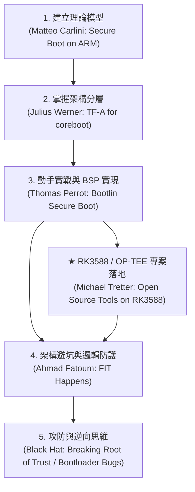

# ARM Secure Boot 研討會精選演講與技術影片指南

本文件收錄 YouTube 上關於 **ARM 安全啟動（Secure Boot / Verified Boot / 信任鏈 Chain of Trust）** 的經典研討會演講影片，涵蓋 ARM 官方規範（TF-A、TBBR）、開源社群實務（Bootlin、Pengutronix、3mdeb、Siemens）、U-Boot / UEFI 機制，以及資安頂會（Black Hat）的硬體與韌體攻防分析。

> 💡 **關聯筆記**：
> - 本庫實機操作與量測：[`notes/verified-boot-notes/`](../verified-boot-notes/vb-intro.md)（MT8189 / Genio 720 實測 BL2 eFuse、TF-A TBB、FIT 簽章、dm-verity 與 LUKS2）
> - 安全世界韌體深入：[`notes/tf-a-and-op-tee-note/`](../tf-a-and-op-tee-note/)

---

## 快速導覽清單

| 分類 | 演講名稱 | 講者 / 組織 | 會議 / 頻道 | 影片連結 |
|---|---|---|---|---|
| **核心架構** | Secure Boot on ARM systems – Building a complete Chain of Trust | Matteo Carlini (ARM) | Linaro Connect (SFO17-201) | [YouTube 觀看](https://www.youtube.com/results?search_query=Linaro+Connect+SFO17-201+Secure+Boot+on+ARM+systems+Matteo+Carlini) |
| **核心架構** | Arm Trusted Firmware for coreboot developers | Julius Werner (Google) | OSFC 2018 | [YouTube 觀看](https://www.youtube.com/results?search_query=OSFC+2018+Arm+Trusted+Firmware+for+coreboot+developers+Julius+Werner) |
| **核心架構** | Secure boot all the way to userspace and upstream | Mikko Rapeli (Linaro) | Linaro / Yocto Virtual Summit | [YouTube 觀看](https://www.youtube.com/results?search_query=Secure+boot+all+the+way+to+userspace+and+upstream+Mikko+Rapeli) |
| **核心架構** | Secure Boot on Arm systems | Alexandre Vicenzi | openSUSE Conference | [YouTube 觀看](https://www.youtube.com/results?search_query=Secure+Boot+on+Arm+systems+Alexandre+Vicenzi+openSUSE) |
| **實務與 SoC** | Secure boot in embedded Linux systems | Thomas Perrot (Bootlin) | Live Embedded Event / Bootlin | [YouTube 觀看](https://www.youtube.com/results?search_query=Secure+boot+in+embedded+Linux+systems+Thomas+Perrot+Bootlin) |
| **實務與 SoC** | Overview of Secure Boot state in the ARM-based SoCs | Maciej Pijanowski (3mdeb) | ELC (Linux Foundation) | [YouTube 觀看](https://www.youtube.com/results?search_query=Overview+of+Secure+Boot+state+in+the+ARM-based+SoCs+3mdeb) |
| **實務與 SoC** | Verified Boot: From ROM to Userspace | Marc Kleine-Budde (Pengutronix) | ELC Europe | [YouTube 觀看](https://www.youtube.com/results?search_query=Verified+Boot+From+ROM+to+Userspace+Marc+Kleine-Budde) |
| **實務與 SoC** | Secure Boot from A to Z | Q. Schulz & M. Josserand (Bootlin) | ELC (Free Electrons) | [YouTube 觀看](https://www.youtube.com/results?search_query=Secure+Boot+from+A+to+Z+Quentin+Schulz+Bootlin) |
| **實務與 SoC** | Implementing UEFI-based Secure Boot + OTA Update for ARM | Jan Kiszka & Christian Storm (Siemens) | ELC (Linux Foundation) | [YouTube 觀看](https://www.youtube.com/results?search_query=Implementing+UEFI-based+Secure+Boot+OTA+Update+Embedded+ARM+Jan+Kiszka) |
| **U-Boot 驗證** | FIT Happens: How Secure Boot Wasn't | Ahmad Fatoum (Pengutronix) | ELC / FOSDEM | [YouTube 觀看](https://www.youtube.com/results?search_query=FIT+Happens+How+Secure+Boot+Wasn%27t+Ahmad+Fatoum) |
| **U-Boot 驗證** | Practical Application of Verified Boot | Rouven Czerwinski (Pengutronix) | ELC (Linux Foundation) | [YouTube 觀看](https://www.youtube.com/results?search_query=Practical+Application+of+Verified+Boot+Rouven+Czerwinski) |
| **RK3588 專題** | Open Source Tools for Secure Boot on Rockchip RK3588 | Michael Tretter (Pengutronix) | Embedded Recipes / BayLibre | [YouTube 觀看](https://www.youtube.com/results?search_query=Open+Source+Tools+for+Secure+Boot+on+Rockchip+RK3588+Michael+Tretter) |
| **RK3588 專題** | Getting the RK3588 SoC supported upstream | Sebastian Reichel (Collabora) | Kernel Recipes 2023 | [YouTube 觀看](https://www.youtube.com/results?search_query=Kernel+Recipes+2023+Getting+the+RK3588+SoC+supported+upstream+Sebastian+Reichel) |
| **資安與攻防** | Breaking Samsung's Root of Trust: S10 Secure Boot | G. Beniamini et al. | Black Hat Official | [YouTube 觀看](https://www.youtube.com/results?search_query=Breaking+Samsung%27s+Root+of+Trust+Exploiting+Samsung+S10+Secure+Boot+Black+Hat) |
| **資安與攻防** | Attacking Samsung Galaxy A* Boot Chain, and Beyond | D. Komaromy | Black Hat Official | [YouTube 觀看](https://www.youtube.com/results?search_query=Attacking+Samsung+Galaxy+Boot+Chain+and+Beyond+Black+Hat) |
| **資安與攻防** | Reflections on Trusting TrustZone | Black Hat Speakers | Black Hat Official | [YouTube 觀看](https://www.youtube.com/results?search_query=Reflections+on+Trusting+TrustZone+Black+Hat) |
| **資安與攻防** | The Bugs in Your Bootloaders: Secure Boot Fails | Security Researchers | Black Hat Official | [YouTube 觀看](https://www.youtube.com/results?search_query=The+Bugs+in+Your+Bootloaders+Embedded+Device+Secure+Boot+Fails+Black+Hat) |

---

## 詳細演講介紹與技術摘要

### 一、 核心標準與架構篇（TF-A、TBBR、UEFI）

#### 1. Secure Boot on ARM systems – Building a complete Chain of Trust
- **講者**：Matteo Carlini（ARM 韌體工程團隊）
- **會議 / 頻道**：Linaro Connect（Session ID: SFO17-201）
- **主題關鍵字**：ARM TBBR (Trusted Board Boot Requirements)、TF-A (Trusted Firmware-A)、EDK2、UEFI Secure Boot
- **核心摘要**：
  - 闡述 ARM 架構從晶片重置（Reset）到作業系統開機的標準開機階段：
    - `BL1` (ROM, EL3) $\rightarrow$ `BL2` (SRAM, EL3) $\rightarrow$ `BL31` (EL3 Runtime, Secure Monitor) $\rightarrow$ `BL32` (OP-TEE / Secure OS) $\rightarrow$ `BL33` (Non-secure Bootloader: U-Boot / EDK2)。
  - 解釋 TBBR 規範中的 X.509 憑證鏈、ROTPK（Root of Trust Public Key）雜湊寫入硬體 eFuse 的原理。
  - 示範如何串接 ARM Trusted Firmware 與 EDK2 UEFI Secure Boot，達成跨硬體廠商的標準信任鏈。
- **推薦原因**：了解 ARM 官方標準 Secure Boot 模型必看的奠基之作。

#### 2. OSFC 2018 - Arm Trusted Firmware for coreboot developers
- **講者**：Julius Werner（Google）
- **會議 / 頻道**：Open Source Firmware Conference (OSFC)
- **主題關鍵字**：ARMv8 64-bit、EL3 Runtime、BL31、coreboot、Rockchip RK3399
- **核心摘要**：
  - 探討 ARM64 特有的 Exception Level（EL0 ~ EL3）以及安全狀態（Secure / Non-secure）。
  - 解釋為何 64 位元 ARM 平台必須常駐一個 EL3 韌體（TF-A BL31）來處理 PSCI 電源管理、CPU 熱插拔與安全呼叫（SMC）。
  - 以 Rockchip RK3399 Chromebook 為實例，分享開源韌體 coreboot 整合 TF-A 時所遇到的陷阱與除錯經驗。

#### 3. Secure boot all the way to userspace and upstream
- **講者**：Mikko Rapeli（Linaro）
- **會議 / 頻道**：Linaro Virtual Connect / Yocto Project Virtual Summit
- **主題關鍵字**：Arm SystemReady、TRS (Trusted Reference Stack)、UKI (Unified Kernel Image)、TPM
- **核心摘要**：
  - 傳統嵌入式與通用伺服器開機流程的收斂（Arm SystemReady 規範）。
  - 介紹如何利用現代 Linux 的 UKI（將 Kernel、initramfs、cmdline、dtb 打包並進行單一簽章），搭配 TPM / TrustZone 進行度量開機（Measured Boot）與完整性驗證。

---

### 二、 嵌入式實戰與各晶片廠實作篇

#### 1. Secure boot in embedded Linux systems
- **講者**：Thomas Perrot（Bootlin 核心工程師）
- **會議 / 頻道**：Live Embedded Event (LEE) / Bootlin
- **投影片**：[Bootlin 官方投影片 PDF](https://bootlin.com/pub/conferences/2021/lee/perrot-secure-boot/perrot-secure-boot.pdf)
- **主題關鍵字**：NXP i.MX8、AHAB (Advanced High Assurance Boot)、CST (Code Signing Tool)、dm-verity、dm-init
- **核心摘要**：
  - 完整走過一塊工業級 ARM 板子（i.MX8）的安全開機實作：
    1. **硬體階段**：生成 SRK（Super Root Keys），將 SRK Hash 燒入晶片 eFuse，開啟晶片的安全閉鎖（Close device）。
    2. **Bootloader 階段**：NXP AHAB ROM 驗證 SPL，SPL 驗證後續 ATF 與 U-Boot。
    3. **Kernel 階段**：U-Boot 透過 FIT Image 驗證 Linux Kernel 與 Device Tree。
    4. **根檔案系統階段**：利用 Linux 核心的 `dm-verity` 對唯讀 rootfs 進行 block-level 即時驗證，並用 `dm-init` 讓核心直接掛載，無須依賴額外的 initramfs。
- **推薦原因**：工程落地步驟最清晰、概念與實作兼備的典範級演講。

#### 2. Overview of Secure Boot state in the ARM-based SoCs
- **講者**：Maciej Pijanowski（3mdeb 嵌入式安全顧問團隊）
- **會議 / 頻道**：Embedded Linux Conference (Linux Foundation)
- **主題關鍵字**：SoC 評比、Allwinner、Rockchip、NXP、STMicroelectronics、開源成熟度
- **核心摘要**：
  - 各晶片廠在 BootROM Secure Boot 實作上的碎片化現況。
  - 比較 NXP (HAB/AHAB)、ST (STM32MP1)、Allwinner、Rockchip 等平台的安全開機工具鏈是否開源、金鑰燒錄是否有回退保護（Anti-rollback）、文檔是否有 NDA 限制。
  - 企業選型評估 SoC 安全性時的關鍵指標。

#### 3. Practical Application of Verified Boot
- **講者**：Rouven Czerwinski（Pengutronix）
- **會議 / 頻道**：The Linux Foundation (Embedded Linux Conference)
- **主題關鍵字**：Yocto `meta-security`、FIT Image、HSM 金鑰保護、GPLv3 條款
- **核心摘要**：
  - 如何在 CI/CD 與 Yocto 自動化建置流程中引入自動簽章。
  - 使用硬體加密棒（Nitrokey / YubiKey HSM）保管簽章私鑰，避免私鑰外洩。
  - 提醒安全開機可能引發的法律合規問題（例如 GPLv3 "Tivoization" 條款對硬體防篡改的限制）。

---

### 三、 Bootloader 驗證與邏輯避坑篇

#### 1. FIT Happens: How Secure Boot Wasn't
- **講者**：Ahmad Fatoum（Pengutronix 韌體工程師）
- **會議 / 頻道**：FOSDEM / The Linux Foundation
- **主題關鍵字**：U-Boot FIT (Flat Image Tree)、簽章混淆、樹狀節點重組、Whole-image Signing
- **核心摘要**：
  - **安全開機設計人員必看！** 深度剖析 U-Boot FIT 映像檔早期驗證邏輯的經典弱點：
    - 由於 Device Tree 結構的靈活性，驗證時如果只驗證葉節點（Nodes），攻擊者可透過注入同名節點或篡改屬性配置來繞過檢查。
    - 示範利用配置混淆直接取得未受保護的執行權限。
    - 介紹新一代 U-Boot FIT 如何引入更嚴謹的驗證模型與 Whole-image 簽章策略。

---

### 四、 資安研究與繞過漏洞分析篇（Black Hat / DEF CON）

#### 1. Breaking Samsung's Root of Trust: Exploiting Samsung S10 Secure Boot
- **頻道**：Black Hat Official
- **主題關鍵字**：Samsung Knox、S-Boot、BootROM、USB 通訊漏洞、ROP
- **核心摘要**：
  - 針對三星旗艦 ARM 處理器平台的 Secure Boot 流程進行硬體與軟體逆向分析。
  - 揭露 S-Boot（第二階段 Bootloader）在處理 USB Download Mode 請求時的記憶體破壞漏洞，成功繞過簽章檢查並執行任意程式碼。

#### 2. Attacking Samsung Galaxy A* Boot Chain, and Beyond
- **頻道**：Black Hat Official
- **主題關鍵字**：MediaTek BootROM (BROM)、SLA/DA 驗證、Little Kernel (LK)
- **核心摘要**：
  - 分析聯發科（MediaTek）ARM SoC 早期 BootROM 的安全通訊協定缺陷。
  - 繞過硬體 Root of Trust 限制，在最早期執行未授權 payload，進而完全控制後續啟動鏈路。

#### 3. The Bugs in Your Bootloaders: Embedded Device Secure Boot Fails and How to Fix Them
- **頻道**：Black Hat Official
- **主題關鍵字**：Bootloader 邏輯漏洞、TOCTOU（Time-of-Check to Time-of-Use）、eFuse 燒錄盲區
- **核心摘要**：
  - 歸納市面上數十款嵌入式產品在設計 Secure Boot 時最常見的致命失誤：
    - TOCTOU 漏洞（檢查完記憶體資料後，非同步 DMA 竄改了資料）。
    - 忘記鎖定 JTAG / 偵錯介面。
    - 忽略 Anti-rollback（防降級版本）計數器，導致舊版本有漏洞的已簽章韌體依然能被刷入。

---

### 五、 Rockchip RK3588 專題篇（TF-A BL31、OP-TEE 與主線開源實作）

#### 1. [ER2026] Open Source Tools for Secure Boot on Rockchip RK3588
- **講者**：Michael Tretter（Pengutronix 韌體工程師）
- **會議 / 頻道**：Embedded Recipes（由 BayLibre 頻道收錄上傳）
- **主題關鍵字**：`RK3588`、`OP-TEE`、`barebox`、`eFuse / OTP`、`TrustZone`、`TZC-400`
- **核心摘要**：
  - **目前最權威的 RK3588 開源 Secure Boot / OP-TEE 實戰演講！**
  - **打破原廠 Blob 限制**：傳統 RK3588 開機流程依賴 Rockchip 原廠封裝的 `rkbin`（包含閉源的 DDR training blob 與閉源 `bl31.elf`），本演講展示如何以完全開源的主線韌體構建安全開機鏈路。
  - **硬體信任根與 eFuse 燒錄**：深入 RK3588 晶片內部 OTP / eFuse 的防篡改機制、公鑰雜湊（Public Key Hash）燒錄流程與 Anti-rollback 計數器設定。
  - **OP-TEE 整合與呼叫**：示範如何在 RK3588 配置 TrustZone 安全記憶體保護區段（TZC-400），運行 upstream OP-TEE OS（BL32），並透過 PTA（Pseudo-Trusted Applications）供 Bootloader 及 Linux 核心調用安全加密服務。

#### 2. Kernel Recipes 2023 - Getting the RK3588 SoC supported upstream
- **講者**：Sebastian Reichel（Collabora 核心開發者）
- **會議 / 頻道**：Kernel Recipes
- **主題關鍵字**：`RK3588 upstream`、`TF-A BL31`、`U-Boot SPL`、`Collabora`、`PSCI`
- **核心摘要**：
  - 記錄 Collabora 將 RK3588 導入主線 Linux 與開源 Bootloader 的工程歷程。
  - 剖析多階段引導架構：BootROM $\rightarrow$ SPL (TPL) $\rightarrow$ TF-A (BL31, EL3 Runtime) $\rightarrow$ U-Boot proper (BL33)。
  - 探討 TF-A 開源 BL31（`PLAT=rk3588`）在處理 PSCI 電源管理、CPU 核心動態開關（Core on/off）以及安全世界 SMC 呼叫時所面臨的底層硬體特性與相容性難題。

---

## 推薦學習路徑

1. **基礎概念**：先觀看 Linaro Matteo Carlini 的演講，掌握 ARM 官方 Trusted Board Boot 的定義與各階段職責。
2. **完整實作**：精讀 Bootlin Thomas Perrot 的演講與 PDF 投影片，掌握 BootROM $\rightarrow$ U-Boot $\rightarrow$ Kernel $\rightarrow$ dm-verity 整體拼圖。
3. **Rockchip / RK3588 落地**：觀看 Michael Tretter 的 *Open Source Tools for Secure Boot on Rockchip RK3588*，了解 eFuse 燒錄、上游 TF-A BL31 與 OP-TEE 的具體配置。
4. **安全審計**：觀看 Ahmad Fatoum 的 *FIT Happens* 與 Black Hat 系列，理解防篡改邊界、Anti-rollback 與實體介面防護的重要性。
